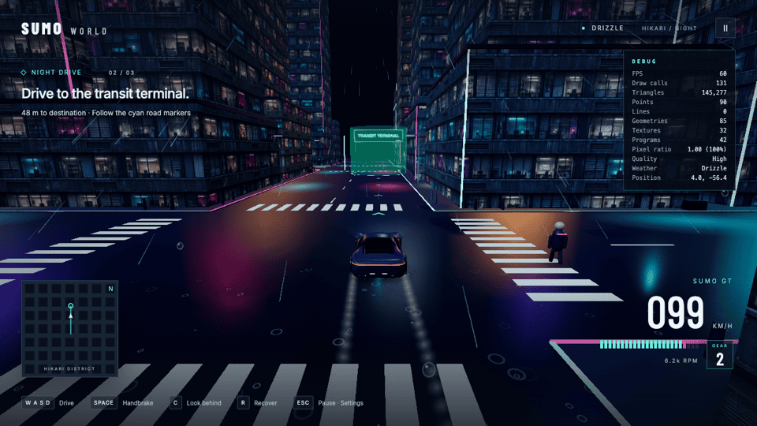

# Sumo World

A browser 3D driving game set in a rain-soaked neon city at night. Walk the streets of the
fictional Hikari District, get into the silver Sumo GT and drive to the transit terminal.
Everything you see is original procedural geometry; there are no real car brands, logos or
third-party models.

Built with Next.js 16, React 19, TypeScript (strict), three.js 0.181 and the Rapier physics
engine (`@dimforge/rapier3d-compat`).



## Run it

Requires Node.js 22 or newer.

```sh
npm ci
npm run dev          # http://127.0.0.1:3000
```

On the author's Mac, double-clicking `Launch-Sumo-World.command` does the same and opens the
browser.

| Command | What it does |
|---|---|
| `npm run dev` | Development server on 127.0.0.1:3000 |
| `npm run check` | Strict TypeScript check |
| `npm test` | Unit and physics tests (`src/game/**` and `src/app/**`, Node test runner via tsx) |
| `npm run build` | Production build (the page is prerendered as static HTML) |
| `npm start` | Serve the production build on 127.0.0.1:3000 |
| `npm run test:e2e` | Playwright smoke test against the production build (run `npm run build` first) |

The smoke test starts `next start` on port 3106 (override with `E2E_PORT`). It uses
Playwright's bundled Chromium; run `npx playwright install chromium` once, or set
`E2E_CHANNEL=chrome` to use an installed Google Chrome.

## Controls

The game is desktop only: keyboard and mouse, or a standard gamepad. Touch devices see a
notice in the menu.

| Key | On foot | Driving |
|---|---|---|
| W A S D / arrows | Walk | Throttle, brake / reverse, steer |
| Mouse | Click the scene to capture the pointer, then look | — |
| Shift | Sprint | — |
| Space | Jump | Handbrake |
| F | Enter the car | Exit when stopped |
| V | First / third person | — |
| C | — | Look behind |
| R | Recover at the garage | Recover at the garage |
| Esc | Pause and settings | Pause and settings |

Gamepad: left stick move/steer, right stick look, right trigger throttle, left trigger
brake/reverse, west button enter/exit, south jump, east handbrake, menu pause.

### Settings

The start and pause menus share one settings panel:

- **Quality**: Low, Medium (default), High or Ultra. Changes pixel-ratio cap, anti-aliasing,
  bloom, ambient occlusion, rain particle budget and draw distance.
- **Auto resolution** (default on): lowers the render resolution while frames run over the
  60 fps budget and raises it again once they recover. Turn it off on displays capped below
  60 Hz, where it can briefly dip before it gives up.
- **Weather**: Auto, Clear, Drizzle (default), Storm or Fog. Weather also changes tyre grip.
- **Low motion**: removes the speed-based field-of-view kick, keeps the chase camera closer
  and turns off menu transitions. It defaults to on when the system asks for reduced motion.
- **Engine audio**: synthesised in the browser with Web Audio. Browsers only allow sound
  after a click, so a saved "on" is restored when you press Enter.

Settings are saved in `localStorage` (`sumo-world:settings:v1`). If storage is blocked, for
example in some private windows, the game still runs with defaults.

Add `?debug` to the URL for an overlay with frame rate, draw calls, triangles, geometries,
textures and shader programs.

## Architecture

The page (`src/app/page.tsx`) is a thin React shell. It dynamically imports the game runtime,
so the menu renders before three.js and Rapier download. The runtime publishes a `Snapshot`
about ten times a second, and the HUD renders from it.

```
src/
  app/                 React shell: menu, loading, settings, HUD, debug overlay
  game/
    core/              types.ts (frozen contracts), runtime.ts (loop), camera, snapshot
    render/            SceneRenderer (WebGL, bloom, fog) and quality presets
    world/             City and people systems
    vehicle/           Car model and drivetrain (rpm / gear)
    weather/           Weather state, rain particles, spray / smoke
    audio/             Synthesised engine note
    physics.ts         Rapier world, ray-cast car, walking capsule
    content.ts         Block layout, spawn, destination, mission rules
    input.ts           Keyboard, mouse and gamepad
```

- **Runtime** (`core/runtime.ts`) owns a fixed 60 Hz physics step with interpolation. Each
  frame it builds one reused `FrameContext` and calls every registered `GameSystem`
  (weather, rain, spray, city, people, audio) in order.
- **Contracts** (`core/types.ts`) are frozen and shared by all teams: `WeatherState`,
  `QualitySettings`, `VehicleTelemetry`, `GameSystem`, `Snapshot` and `RuntimeApi`. Units
  are metres, seconds, radians and m/s; +Y is up and the car faces +Z.
- **RuntimeApi** is the only surface the UI calls: `start`, `pause`, `restart`, `recover`,
  `setQuality`, `setWeather`, `toggleRain`, `toggleSound`, `toggleMotion`, `getDebugInfo`.
- **Physics** reads weather grip through `Simulation.setGripFactor` before each batch of steps.

### Loading progress

The loading bar reports real stage boundaries: downloading the engine bundle, starting
WebGL, and building the physics world and city. It does not report bytes within a stage,
because the runtime does not expose per-system progress yet.

### Bundle size

`@dimforge/rapier3d-compat` embeds its WebAssembly as base64 inside JavaScript, so the game
chunk is about 2.8 MB (about 1 MB gzipped). It is kept for now because:

- it only loads through the dynamic import, after the menu is on screen, so it does not
  block first paint;
- the non-compat `@dimforge/rapier3d` package needs bundler WebAssembly support that would
  have to be proven with Turbopack and touches `physics.ts`, which the driving team owns;
- the compat build works unchanged in Node, so the physics tests share the browser code.

Moving to a separately served `.wasm` file is the next step if load time becomes a problem.

## Deployment (Vercel)

The only route is prerendered as static content (`○ /` in the build output), so any static
host works. On Vercel:

1. Import the repository. The Next.js preset needs no changes: build `npm run build`,
   install `npm ci`.
2. Leave `output` unset. Static export (`output: 'export'`) would drop the security headers
   in `next.config.ts`, because headers are applied by the Next.js server or Vercel's edge,
   not by plain file hosting. On a pure static host, copy those headers into the host's own
   configuration instead.
3. No environment variables, database or serverless functions are needed.

### Security headers

`next.config.ts` sends these on every route:

- `Content-Security-Policy`: everything from `'self'`. Scripts allow `'unsafe-inline'` for
  Next's inline bootstrap (a nonce would force dynamic rendering) and `'wasm-unsafe-eval'`
  for Rapier's WebAssembly. Development also allows `'unsafe-eval'` and WebSockets for hot
  reload. `frame-ancestors 'none'` blocks framing.
- `X-Frame-Options: DENY`, `X-Content-Type-Options: nosniff`,
  `Referrer-Policy: strict-origin-when-cross-origin`, `Cross-Origin-Opener-Policy: same-origin`.
- `Strict-Transport-Security` (two years, subdomains).
- `Permissions-Policy` turns off camera, microphone, geolocation, payment and USB.
- `/assets/*` is cached for a day with a week of stale-while-revalidate.
- The `X-Powered-By` header is turned off.

## Continuous integration

`.github/workflows/ci.yml` runs on every push and pull request:

1. `npm ci`, `npm run check`, `npm test`, `npm run build`;
2. then a Playwright job that installs Chromium, serves the build and runs the smoke test.
   The test loads the page, checks the security headers, enters the city, holds W, checks
   that the player moved and the canvas rendered, changes settings, reloads, and fails on
   any console error.

## Assets and provenance

See [ASSET-NOTES.md](ASSET-NOTES.md). The concept image is kept for reference in
`assets-source/concept.png` and is not shipped. Screenshots of the current build are in
`docs/screenshots/`.

More play notes: [PLAY-GUIDE.md](PLAY-GUIDE.md).
